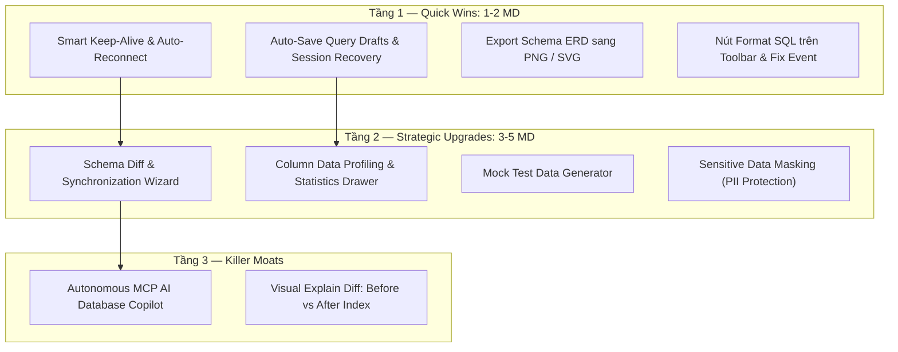

# 🔎 BÁO CÁO PRODUCT TEARDOWN & PHẢN BIỆN TÍNH NĂNG CHUYÊN SÂU
**Sản phẩm:** Tabularis Database Studio (v0.13.16)  
**Phân khúc:** Developer Database Client & Management IDE  
**Siêu ứng dụng đối chiếu:** DataGrip (JetBrains), TablePlus, DBeaver Enterprise, Supabase Studio  
**Ngày thực hiện:** 22/10/2026  

---

## 1. Executive Summary

| Chỉ số | Đánh giá | Ghi chú |
|---|:---:|---|
| **Điểm số trưởng thành (Product Maturity)** | **7.8 / 10** | Tăng mạnh từ 6.5 sau khi hoàn thiện Foreign Key 1-Click Jump, Value Inspector, Multi-format Copy, Query History (Ctrl+H) và Transaction Controls |
| **Time-to-Value (TTV)** | **8.5 / 10** | Tốc độ mở bảng, xem dữ liệu cực nhanh; khởi động dưới 1.5s nhờ kiến trúc Tauri v2 native |
| **Cognitive Load & Ergonomics** | **7.5 / 10** | Giao diện hiện đại, tối giản; tuy nhiên vẫn còn một số điểm ma sát khi đứt kết nối hoặc đóng tab ngoài ý muốn |
| **Retention & Daily Stickiness** | **7.2 / 10** | Lập trình viên dùng hàng ngày cho truy vấn cơ bản nhưng vẫn phải chuyển sang DataGrip/DBeaver khi cần so sánh cấu trúc (Schema Diff) hoặc sinh dữ liệu test |
| **Business Moat & Defensibility** | **7.8 / 10** | Lợi thế lớn nhờ tích hợp MCP (Model Context Protocol) và Visual Explain, cần đào sâu thêm AI Copilot nội suy |

### 💥 3 Tử huyệt lớn nhất (Critical UX & Reliability Leaks)
1. **Ngắt kết nối ngầm khi máy nghỉ (Idle Connection Drop) mà thiếu cơ chế Keep-Alive & Auto-Reconnect 1-Click:**  
   Khi người dùng rời máy 2–5 phút, kết nối socket đến CSDL (đặc biệt qua WSL/Docker/SSH) bị đóng. Tabularis chỉ hiển thị toast lỗi thụ động mà không có keep-alive ping định kỳ và thiếu nút "Thử kết nối lại ngay", làm đứt gãy mạch làm việc.
2. **Thiếu cơ chế Tự động lưu nháp & Phục hồi phiên làm việc (Tab Session Recovery & Crash Resilience):**  
   Các tab truy vấn chưa lưu (`Untitled-1`, `Untitled-2`) nằm hoàn toàn trên RAM. Nếu vô tình tắt cửa sổ hoặc cập nhật OS, toàn bộ câu lệnh SQL đang viết dở biến mất, không đạt chuẩn "Zero-Data-Loss" của TablePlus và DataGrip.
3. **Chưa có công cụ So sánh & Đồng bộ CSDL (Schema Compare / Diff Wizard):**  
   Nỗi đau lớn nhất của backend developer là lệch cấu trúc giữa môi trường Local và Staging/Dev. Việc thiếu chức năng so sánh schema và sinh lệnh `ALTER TABLE` bù đắp khiến lập trình viên vẫn bắt buộc phải cài thêm công cụ bên thứ ba.

### 🌟 3 Cơ hội vàng bứt phá (Unfair Competitive Moats)
1. **Schema Diff & Smart Migration Generator:** Cho phép chọn 2 CSDL (hoặc 2 schema) để quét chênh lệch bảng, cột, khóa, chỉ mục và xuất file migration SQL 1-click.
2. **Mock Test Data Generator (Sinh dữ liệu mẫu thông minh):** Tự động đọc kiểu dữ liệu của bảng để sinh 10–500 dòng dữ liệu thử nghiệm ngẫu nhiên nhưng chuẩn thực tế (tên, email, ngày tháng, UUID, số tiền), giải phóng dev khỏi việc gõ tay.
3. **Column Profiling & Sensitive Data Masking:** Bấm vào tiêu đề cột hiển thị ngay biểu đồ phân bổ dữ liệu (Null %, Distinct count, Min/Max), đi kèm chế độ che mờ dữ liệu nhạy cảm (PII masking) an toàn tuyệt đối khi demo hoặc chia sẻ màn hình.

---

## 2. Bảng đối chiếu Hiện trạng Mã nguồn với Siêu ứng dụng Đầu ngành (Tier-1 Gap Analysis)

| Tính năng cốt lõi | DataGrip | TablePlus | DBeaver | Tabularis (Hiện tại) | Đánh giá & Khoảng cách |
|---|:---:|:---:|:---:|:---:|---|
| **Điều hướng khóa ngoại 1-click (FK Jump)** | ✅ | ✅ | ✅ | ✅ Có (v0.13.16) | Đã đạt chuẩn Tier-1 (Link icon + Ctrl+Click + Tooltip) |
| **Soi chi tiết ô dữ liệu (Value Inspector)** | ✅ | ✅ | ⚠️ Modal rời | ✅ Có (v0.13.16) | Đã đạt chuẩn Tier-1 (Text/JSON Tree/Hex Dump drawer) |
| **Sao chép đa định dạng (Copy As)** | ✅ | ✅ | ✅ | ✅ Có (v0.13.16) | Vượt trội với JSON, INSERT, CSV, Markdown, TypeScript |
| **Lịch sử truy vấn nâng cao (Query History)** | ✅ (Ctrl+E) | ✅ | ✅ | ✅ Có (Ctrl+H) | Đầy đủ tìm kiếm, lọc trạng thái, chèn vào editor |
| **Kiểm soát giao dịch (Commit/Rollback)** | ✅ | ✅ | ✅ | ✅ Có (v0.13.16) | Nút chuyển Auto-Commit / Manual trực quan |
| **Tự lưu tab nháp (Session Crash Recovery)** | ✅ | ✅ | ✅ | ❌ Chưa có | Chỉ lưu độ rộng pane, mất tab SQL khi tắt app |
| **Keep-Alive & Tự động kết nối lại** | ✅ | ✅ | ✅ | ⚠️ Thụ động | Chỉ báo lỗi toast, chưa tự động ping giữ cổng |
| **So sánh cấu trúc Database (Schema Diff)** | ✅ Rất mạnh | ❌ Cần plugin | ✅ | ❌ Chưa có | Lỗ hổng lớn đối với phân khúc DBA / Senior Dev |
| **Thống kê phân bổ cột (Column Profiling)** | ✅ | ⚠️ Cơ bản | ✅ | ❌ Chưa có | Phải viết query đếm tay thủ công |
| **Sinh dữ liệu mẫu (Mock Data Generator)** | ✅ | ❌ | ✅ | ❌ Chưa có | Mới có sinh template CRUD, chưa có sinh row data |
| **Xuất sơ đồ ERD ra ảnh (Export Diagram)** | ✅ | ⚠️ Hạn chế | ✅ | ⚠️ Chưa có nút xuất | ERD xem được nhưng chưa có nút xuất PNG/SVG |
| **Che mờ dữ liệu nhạy cảm (Data Masking)** | ✅ | ❌ | ✅ | ❌ Chưa có | Mới che mật khẩu trong AI context |
| **Tích hợp giao thức AI MCP Server** | ❌ | ❌ | ❌ | ✅ Độc quyền | Lợi thế cạnh tranh vượt trội sẵn sàng cho AI Agent |

---

## 3. Danh mục Đề xuất Tính năng Mới (3 Tầng Hành động)

### 🟢 Tầng 1: Quick Wins (Triển khai nhanh 1–2 MD — Ăn điểm UX lập tức)

1. **Smart Keep-Alive Ping & 1-Click Auto-Reconnect:**
   - *Vấn đề:* Người dùng kết nối CSDL qua WSL/Docker/mạng từ xa, sau 2 phút không thao tác là socket bị server ngắt kết nối.
   - *Giải pháp:*
     - Định kỳ mỗi 45 giây gửi gói ping nhẹ (`SELECT 1;`) khi kết nối đang active.
     - Khi phát hiện rớt mạng, hiển thị badge màu vàng cam trên góc status bar kèm nút bấm **"Thử kết nối lại" (Reconnect 1-click)** tự động mở lại connection pool mà không bắt người dùng phải tải lại cả ứng dụng.
2. **Auto-Save Query Drafts & Workspace Session Recovery (Chống mất code nháp):**
   - *Vấn đề:* Các tab editor chưa lưu nếu tắt máy hoặc đóng app bất ngờ sẽ mất sạch câu SQL đang viết.
   - *Giải pháp:* Tự động lưu nội dung các tab đang mở (kể cả tab chưa lưu) vào IndexedDB / LocalStorage theo chu kỳ 1 giây. Khi mở lại app, toàn bộ các tab và vị trí con trỏ được khôi phục nguyên vẹn 100%.
3. **Xuất Sơ đồ CSDL (ERD Diagram) ra file PNG / SVG / Mermaid:**
   - *Vấn đề:* Trang `SchemaDiagramPage` đã vẽ quan hệ bảng rất đẹp bằng ReactFlow nhưng chưa có nút lưu ảnh để gửi cho sếp, đối tác hoặc chèn vào tài liệu thiết kế.
   - *Giải pháp:* Thêm nút **"Xuất hình ảnh" (Export Image)** hỗ trợ định dạng PNG (độ phân giải cao 2x) và SVG vector trực tiếp.
4. **Nút Format SQL trực quan trên Toolbar & Khớp lệnh phím tắt:**
   - *Vấn đề:* Hiện có tính năng format SQL bằng thư viện `sql-formatter` nhưng chưa có nút bấm trên thanh công cụ nổi của Monaco Editor, và event `tabularis:format-sql` từ Quick Navigator chưa được bắt.
   - *Giải pháp:* Bổ sung nút cây đũa phép (Wand2 / AlignLeft) trên thanh công cụ nổi của Editor với phím tắt gợi ý `Ctrl + Alt + F`.

---

### 🟡 Tầng 2: Strategic Upgrades (Nâng cấp Chiến lược 3–5 MD — Tăng chiều sâu chuyên môn)

1. **Schema Diff & Database Compare Wizard (So sánh cấu trúc 2 CSDL):**
   - *Mô tả:* Cho phép chọn CSDL Nguồn (ví dụ: `production`) và CSDL Đích (ví dụ: `staging` hoặc `local dev`).
   - *Kết quả so sánh:*
     - Danh sách bảng chỉ có ở nguồn / chỉ có ở đích.
     - Bảng có cấu trúc cột lệch nhau (thiếu cột, khác kiểu dữ liệu, khác nullability/default).
     - Thiếu Index hoặc khác biệt Foreign Key.
   - *Hành động:* Tự động sinh file script `ALTER TABLE / ADD COLUMN / CREATE INDEX` để đồng bộ chỉ trong 1 click.
2. **Column Data Profiling & Statistics Drawer (Soi thống kê phân bổ dữ liệu cột):**
   - *Mô tả:* Click chuột phải vào tiêu đề cột trên DataGrid ➔ Chọn **"Thống kê cột (Column Profile)"**.
   - *Thông số hiển thị:*
     - Tỷ lệ dữ liệu rỗng: `Null count / Total rows (%)`.
     - Số lượng giá trị duy nhất: `Distinct count`.
     - Phân tích số học (với cột số/ngày): `Min`, `Max`, `Average`.
     - Biểu đồ Top 5 giá trị chiếm tần suất cao nhất (Frequency mini-chart).
3. **Mock Test Data Generator (Bộ sinh dữ liệu thử nghiệm tự động):**
   - *Mô tả:* Click chuột phải vào bảng ➔ Chọn **"Sinh dữ liệu mẫu (Generate Mock Data)"**.
   - *Cơ chế:* Đọc metadata cột và tự động khớp generator:
     - Cột `email` ➔ sinh email ngẫu nhiên hợp lệ.
     - Cột `phone` / `tel` ➔ sinh số điện thoại mẫu.
     - Cột `name` / `full_name` ➔ sinh tên người thực tế.
     - Cột `created_at` ➔ sinh timestamp trong khoảng 30 ngày qua.
     - Cột `status` ➔ sinh các giá trị ngẫu nhiên trong enum/check constraint.
   - Cho phép chọn số lượng dòng (10, 50, 100, 500 dòng) và chèn trực tiếp hoặc xuất thành file `INSERT.sql`.
4. **Sensitive Data Masking (Bảo vệ thông tin nhạy cảm khi hiển thị):**
   - *Mô tả:* Nút gạt **"Chế độ bảo mật (Mask PII)"** trên thanh công cụ của DataGrid.
   - *Tác dụng:* Tự động nhận diện các cột nhạy cảm (`email`, `phone`, `password`, `ssn`, `credit_card`, `token`, `salary`) và hiển thị che mờ dạng `jo***@gmail.com`, `****-1234`. Giúp dev tự tin chia sẻ màn hình khi họp hoặc làm việc ở quán café.

---

### 🔴 Tầng 3: Killer Moats (Rào cản Cạnh tranh Áp đảo — Độc quyền Tabularis)

1. **Autonomous MCP Database Copilot & Query Performance Tuner:**
   - Tận dụng kiến trúc MCP Server sẵn có của Tabularis: Khi một câu truy vấn chạy vượt quá 1000ms, hệ thống tự động gắn nhãn "Chậm" kèm gợi ý từ AI Copilot:
     - Tự động chạy ngầm `EXPLAIN` phân tích.
     - Phát hiện nguyên nhân cốt lõi: *"Truy vấn bị Sequential Scan trên bảng 200.000 dòng do thiếu index cột `user_id`"*.
     - Cung cấp nút 1-click: **"Tạo Index tối ưu: CREATE INDEX idx_users_user_id ON orders(user_id);"**
2. **Visual Explain Plan Diff (So sánh Kế hoạch thực thi trực quan):**
   - Hiển thị 2 cây đồ thị Explain Plan cạnh nhau để lập trình viên thấy rõ sự thay đổi giữa câu truy vấn trước và sau khi thêm điều kiện lọc hoặc đánh chỉ mục (giảm Node Cost, chuyển từ Seq Scan sang Index Scan).

---

## 4. Lộ trình Triển khai & Khuyến nghị Kỹ thuật (Implementation Roadmap)

| Giai đoạn | Hạng mục công việc | Các file mã nguồn tác động chính | Độ phức tạp |
|---|---|---|:---:|
| **Đợt 1 (Quick Wins)** | 1. Thêm Smart Keep-Alive Ping & nút Reconnect 2. Auto-save tab draft vào IndexedDB 3. Nút xuất ảnh ERD PNG/SVG 4. Nút Format SQL trên Editor floating toolbar | `ConnectionHealthMonitor.tsx` `src-tauri/src/connections.rs` `Editor.tsx`, `useEditor.ts` `SchemaDiagramPage.tsx` `SqlEditorWrapper.tsx` | **Thấp** (1–2 ngày) |
| **Đợt 2 (Strategic)** | 1. Column Data Profiling Drawer 2. Sensitive Data Masking toggle 3. Mock Test Data Generator | `DataGrid.tsx` `ColumnProfileModal.tsx` `mockDataGenerator.ts` `MockDataModal.tsx` | **Vừa** (3–4 ngày) |
| **Đợt 3 (Enterprise)** | 1. Schema Compare & Diff Synchronization Wizard 2. AI Autonomous Performance Tuner | `SchemaDiffModal.tsx` `schemaDiff.ts` `src-tauri/src/introspection.rs` | **Cao** (5–7 ngày) |
